<div align="center" dir="rtl">

# 💳 کارت به کارت حرفه‌ای ووکامرس

**درگاه کارت به کارت کامل برای ووکامرس — با کارت هم‌رنگ و هم‌شکل بانک، صفحه پرداخت اختصاصی، آپلود و بررسی رسید، مهلت و لغو خودکار، پیامک ملی‌پیامک، افزونه‌های اختیاری (تخفیف، سقف کارت، شرط نمایش، تشخیص رسید تکراری) و یک پنل تنظیمات مدرن.**

روی **هر قالبی** کار می‌کند: قالب‌های کلاسیک، قالب‌های بلوکی (FSE) و حالت صفحه مستقل.


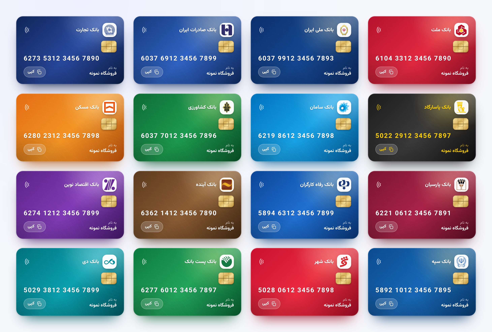

</div>

<div dir="rtl">

## ✨ چرا این افزونه؟

کارت به کارت در ووکامرس معمولاً یعنی یک متن خشک در صفحه تشکر و ده‌ها پیام «رسید رو کجا بفرستم؟». این افزونه کل مسیر را حرفه‌ای می‌کند:

| | |
|---|---|
| 🎨 **کارت هم‌رنگ بانک** | شماره کارت روی یک کارت بانکی واقعی نمایش داده می‌شود: رنگ، گرادیان و لوگوی **۳۷ بانک و موسسه ایرانی**، تراشه طلایی، الگوی گیلوشه و جلوه سه‌بعدی با حرکت نشانگر. بانک از روی BIN شماره کارت یا کد شبا **خودکار** تشخیص داده می‌شود. |
| 🔗 **صفحه پرداخت اختصاصی** | بعد از ثبت سفارش، مشتری به یک صفحه خصوصی (`/card-pay/…`) می‌رود: کارت، مبلغ به عدد و حروف (و **به ریال** در فروشگاه‌های تومانی، چون بیشتر اپ‌های بانکی ریال می‌خواهند)، مهلت با شمارش معکوس («۲ ساعت و ۱۰ دقیقه مانده»)، دکمه‌های کپی و فرم ارسال رسید. لینک با HMAC امضا شده و قابل حدس نیست، **بدون ورود** کار می‌کند و تا پایان عمر سفارش معتبر است. |
| 🧾 **رسید و بررسی** | آپلود عکس یا PDF با پیش‌نمایش، شماره پیگیری، ۴ رقم آخر کارت و **فیلدهای دلخواه**. عکس‌های بزرگ گوشی (و HEIC آیفون) پیش از آپلود در خود مرورگر **کوچک و به JPEG تبدیل** می‌شوند، پس روی هاستی با سقف آپلود ۲ مگابایت هم رد نمی‌شوند. مدیر در پنل یا صفحه سفارش رسید را می‌بیند و با یک کلیک **تأیید** یا با دلیل **رد** می‌کند. |
| ⏱️ **مهلت و لغو خودکار** | مهلت ارسال رسید، پیامک یادآوری پیش از پایان مهلت و لغو خودکار سفارش با برگشت موجودی انبار. |
| 🛡️ **حالت سخت‌گیرانه** | تا رسید تأیید نشده، سفارش حتی با تغییر دستی وضعیت یا عملیات گروهی «در حال انجام» نمی‌شود. |
| 📱 **پیامک ملی‌پیامک** | دو روش قابل انتخاب: **پترن** (خط خدماتی اشتراکی) و **خط اختصاصی/اشتراکی** (متن کامل) + **آزمایش اتصال** با نمایش اعتبار و ارسال پیامک آزمایشی. |
| 🧑‍💼 **حساب کاربری ووکامرس** | دکمه «ارسال رسید» در لیست سفارش‌ها (به‌جای دکمه «پرداخت» ووکامرس)، کارت و تاریخچه رسیدها در جزئیات سفارش، لغو توسط مشتری، یادداشت برای مشتری. مشتری‌ای که صفحه را بسته از حساب کاربری، پیامک یا ایمیل با یک کلیک به فرم برمی‌گردد. |
| 🧩 **افزونه‌های اختیاری** | تخفیف یا کارمزد کارت به کارت، سقف دریافت روزانه و ماهانه هر کارت، شرط نمایش درگاه و کارت، و تشخیص رسید تکراری و مشکوک. هر کدام جدا روشن می‌شود و افزونه خاموش هیچ اثری روی سایت ندارد. |
| 🗂️ **نگهداری فایل رسید** | حذف خودکار فایل‌ها بعد از N روز برای رسیدهای تأییدشده، ردشده و سفارش‌های لغوشده؛ حذف همراه با حذف سفارش. |
| ⚙️ **پنل تنظیمات مدرن** | React + Tailwind با کامپوننت‌های متحرک [طرحک](https://tarhak.ir)، پیش‌نمایش زنده کارت، حالت تیره و ذخیره با `Ctrl/⌘ + S`. |

## 📸 تصاویر

### صفحه پرداخت مشتری

<p align="center">
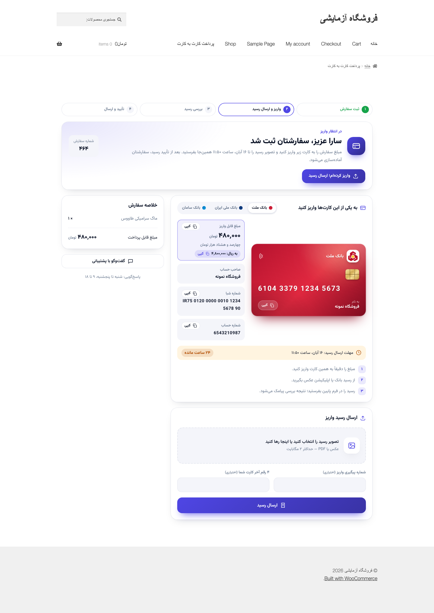
&nbsp;
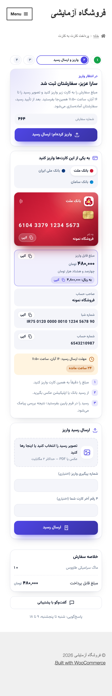
</p>

| انتخاب روش پرداخت در چک‌اوت بلوکی | فرم ارسال رسید | رسید در حال بررسی |
|---|---|---|
| 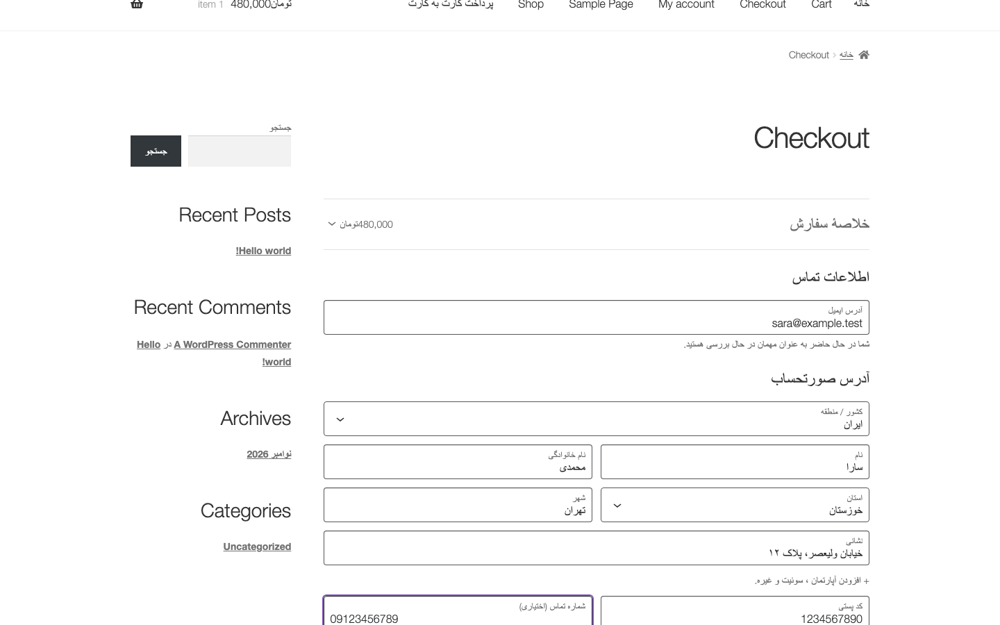 | 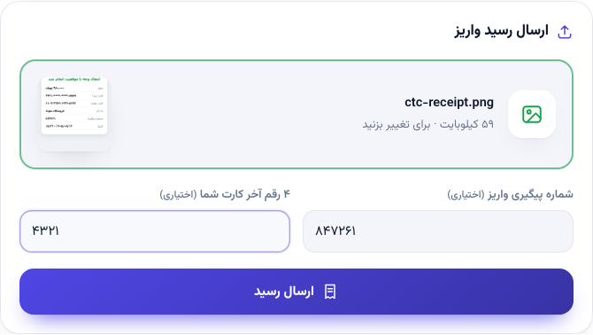 | 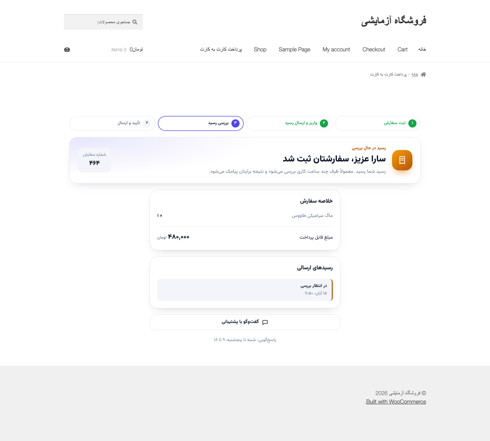 |

### پنل تنظیمات (ووکامرس › کارت به کارت)

| داشبورد | رسیدها: تأیید با مهر |
|---|---|
| 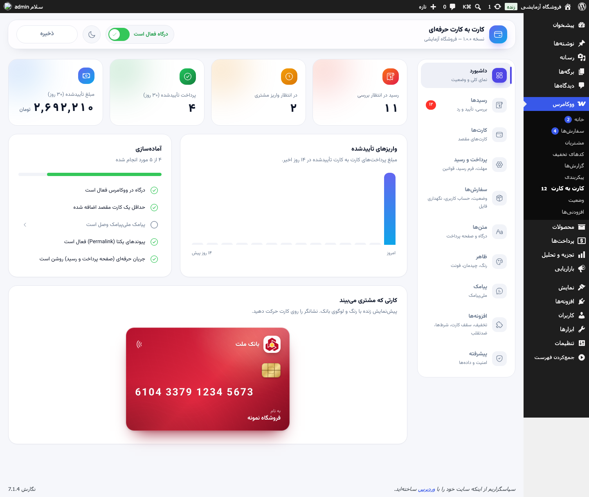 | 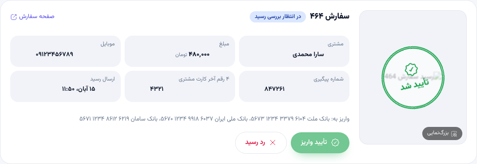 |

| کارت‌ها با پیش‌نمایش زنده | حالت تیره |
|---|---|
| 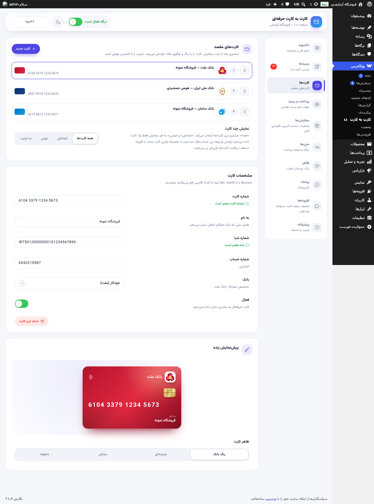 | 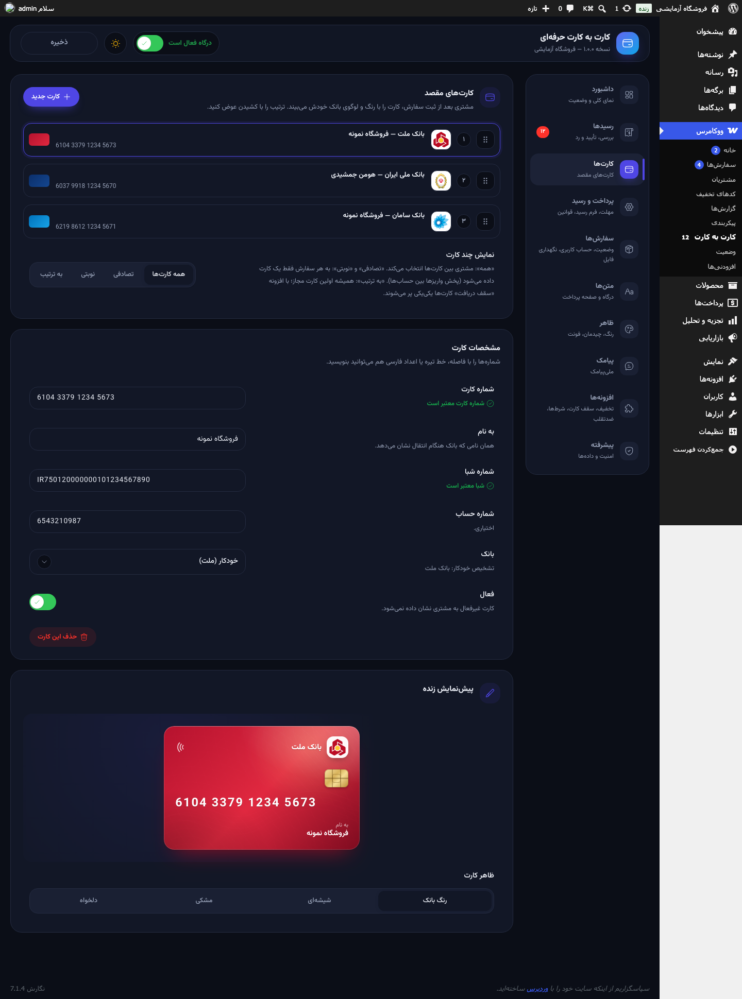 |

| پیامک: حالت پترن | پیامک: خط اختصاصی / اشتراکی |
|---|---|
| 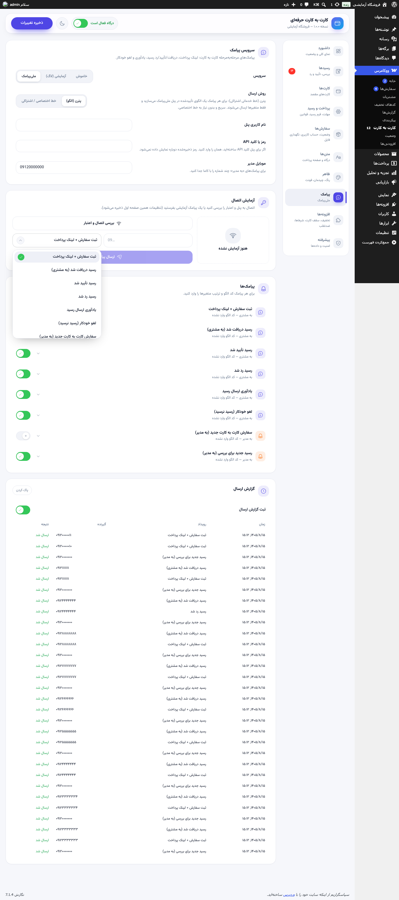 | 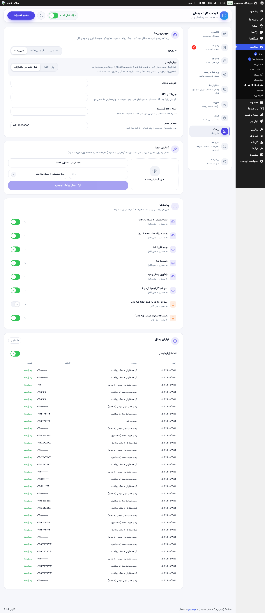 |

| افزونه‌های اختیاری | لیست رسیدها |
|---|---|
| 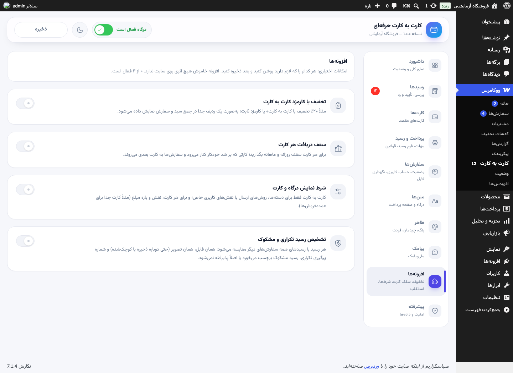 | 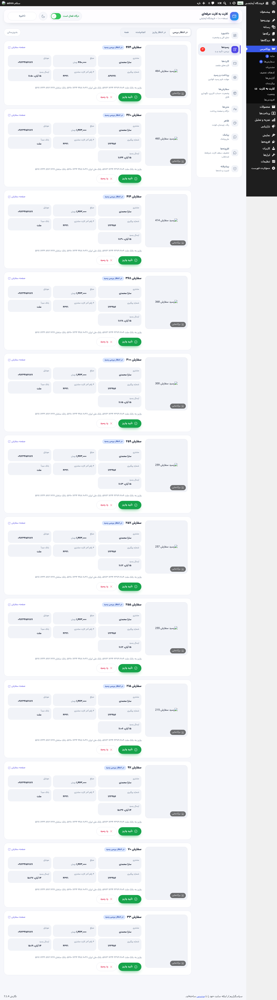 |

| پرداخت، فرم رسید و قوانین | ظاهر صفحه پرداخت | جعبه رسید در صفحه سفارش |
|---|---|---|
| 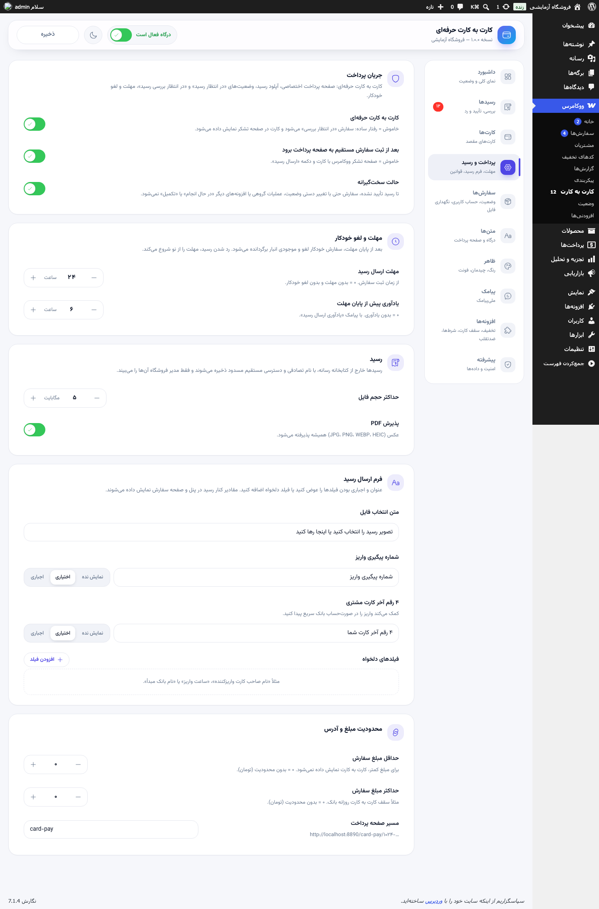 | 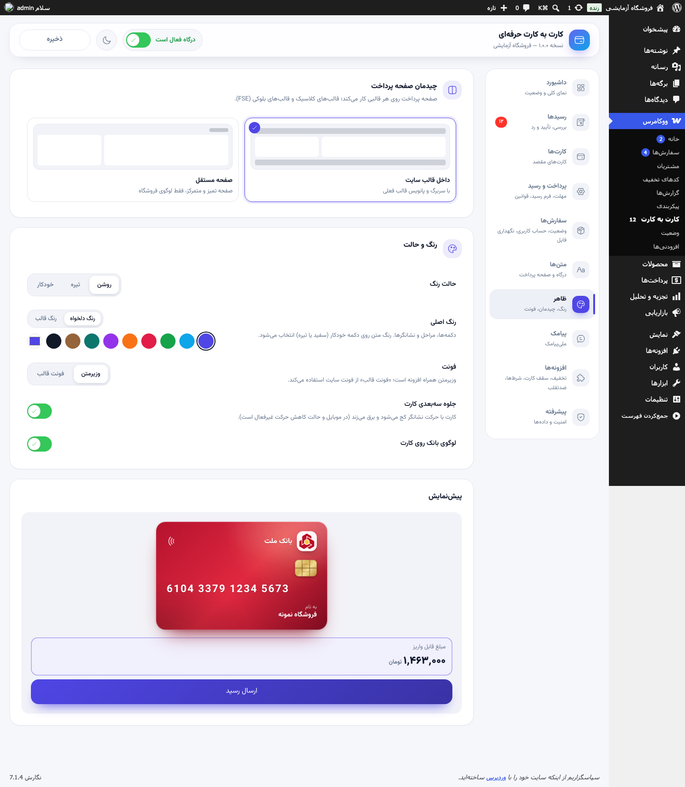 | 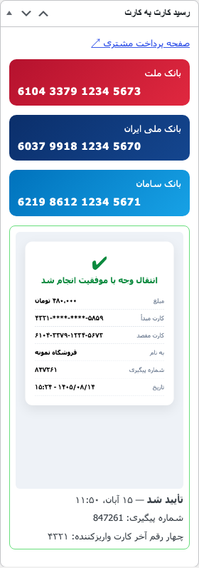 |

## 🚀 نصب

1. آخرین نسخه را از بخش [Releases](https://github.com/hoomanjamshidi/card-to-card-plugin/releases) دانلود کنید (یا با `bash bin/zip.sh` بسازید).
2. در وردپرس: **افزونه‌ها › افزودن › بارگذاری افزونه** و فایل زیپ را نصب و فعال کنید.
3. به **ووکامرس › کارت به کارت** بروید:
   - در تب **کارت‌ها** کارت مقصد را اضافه کنید (بانک خودکار تشخیص داده می‌شود)؛
   - سوئیچ **«درگاه فعال است»** را در بالای پنل روشن کنید.
4. تمام! حالا «کارت به کارت» در صفحه پرداخت (کلاسیک و بلوکی) نمایش داده می‌شود.

> **پیش‌نیاز:** وردپرس ۶.۴+، ووکامرس ۸+، PHP 8.0+ — سازگار با HPOS و چک‌اوت بلوکی.

## 🔄 جریان سفارش

```
ثبت سفارش ─► «در انتظار رسید» (موجودی رزرو) ─► صفحه پرداخت خصوصی ─► آپلود رسید
     │                                                                 │
     │ پایان مهلت بدون رسید                                            ▼
     ▼                                                    «در انتظار بررسی رسید»
 لغو خودکار + برگشت موجودی                                  │                    │
                                                         تأیید ✔               رد ✖ (با دلیل)
                                                           │                    │
                                                 «در حال انجام / تکمیل»   برگشت به «در انتظار رسید»
                                                                           با مهلت تازه
```

هر مرحله می‌تواند پیامک و ایمیل داشته باشد. دو وضعیت سفارشی `wc-ctc-receipt` و `wc-ctc-review` در لیست سفارش‌ها با رنگ اختصاصی نمایش داده می‌شوند.

### مشتری صفحه را بست؛ چطور رسید را بفرستد؟

همه این راه‌ها به همان لینک خصوصی می‌رسند و هیچ‌کدام ورود به حساب نمی‌خواهند. اطلاعات سفارش در چک‌اوت گرفته شده، پس مشتری فقط عکس رسید را می‌فرستد:

- **پیامک** «ثبت سفارش»، «یادآوری» و «رسید رد شد» با لینک کامل (`{link}`) یا کلید آن (`{key}`)؛
- دکمه **«ارسال رسید واریز»** در ایمیل سفارش؛
- **حساب کاربری › سفارش‌ها** › «ارسال رسید»، یا جعبه کارت در جزئیات سفارش؛
- جعبه کارت در **صفحه تشکر**.

بالای صفحه پرداخت دکمه **«واریز کرده‌ام؛ ارسال رسید»** مستقیم به فرم می‌رود. بعد از رد شدن رسید، همان لینک دلیل رد و یک فرم تازه نشان می‌دهد.

## 🧩 افزونه‌های اختیاری

در تب **افزونه‌ها** هر کدام را که لازم دارید روشن کنید:

| افزونه | کار |
|---|---|
| **تخفیف یا کارمزد** | تخفیف (مثلاً «۲٪ تخفیف با کارت به کارت») یا کارمزد درصدی یا ثابت، با سقف، حداقل و گرد کردن. به‌صورت یک ردیف جدا در چک‌اوت کلاسیک و بلوکی و در سفارش ثبت می‌شود و اگر مشتری روش پرداخت را عوض کند حذف می‌شود. |
| **سقف دریافت هر کارت** | سقف روزانه و ماهانه (شمسی) برای هر کارت مقصد. کارتی که با این سفارش از سقف رد شود داده نمی‌شود و سفارش به کارت بعدی می‌رود. اگر کارتی نماند، کارت به کارت پنهان می‌شود. مبلغ سفارش لغوشده یا مسترد شده آزاد می‌شود. |
| **شرط نمایش** | نمایش درگاه فقط برای دسته‌های محصول، روش‌های ارسال یا نقش‌های کاربری خاص؛ و برای هر کارت نقش و بازه مبلغ (مثلاً کارت جدا برای عمده‌فروش‌ها یا سفارش‌های بزرگ). |
| **رسید تکراری و مشکوک** | هر رسید با رسیدهای همه سفارش‌های دیگر مقایسه می‌شود: همان فایل، همان تصویر (حتی دوباره ذخیره یا کوچک‌شده) و شماره پیگیری تکراری. رسید مشکوک در پنل و صفحه سفارش برچسب «⚠️ مشکوک» می‌گیرد یا در حالت سخت اصلاً پذیرفته نمی‌شود. اثر انگشت رسیدها بعد از حذف فایل هم می‌ماند. |

## 📱 راه‌اندازی پیامک ملی‌پیامک

در تب **پیامک** سرویس را روی «ملی‌پیامک» بگذارید و نام کاربری و رمز (یا کلید API) را وارد کنید. سپس یکی از دو روش:

### روش ۱ — پترن (خط خدماتی اشتراکی) — پیشنهادی
برای هر پیامک یک الگو در پنل ملی‌پیامک بسازید و بعد از تأیید، کد الگو (bodyId) را وارد کنید. ترتیب متغیرها را خودتان تعیین می‌کنید؛ مثلاً با ترتیب `{name} {order} {total} {key}`:

```text
{0} عزیز، سفارش {1} ثبت شد.
مبلغ {2} را کارت به کارت کنید و رسید را بفرستید:
https://your-shop.ir/card-pay/{3}
لغو11
```

> ملی‌پیامک لینک را داخل متغیر نمی‌پذیرد (خطای ‎-10)؛ برای همین آدرس ثابت را در متن الگو بنویسید و فقط `{key}` را متغیر بگذارید.

### روش ۲ — خط اختصاصی / اشتراکی (ارسال ساده)
شماره خط فرستنده را وارد کنید و متن کامل هر پیامک را با متغیرها بنویسید؛ پیش‌نمایش زنده کنار هر متن نمایش داده می‌شود.

**متغیرها:** `{name}` `{first_name}` `{order}` `{total}` `{link}` `{key}` `{deadline}` `{card}` `{bank}` `{holder}` `{reason}` `{shop}`

**پیامک‌ها:** ثبت سفارش + لینک پرداخت، رسید دریافت شد، رسید تأیید شد، رسید رد شد (با دلیل)، یادآوری، لغو خودکار، سفارش جدید و رسید جدید (به مدیر، چند شماره).

دکمه **«بررسی اتصال و اعتبار»** ارتباط با پنل را آزمایش و اعتبار را نمایش می‌دهد؛ **«ارسال پیامک آزمایشی»** یک پیام واقعی با الگو یا متن انتخابی می‌فرستد. خطاهای ملی‌پیامک با توضیح فارسی در گزارش ارسال ثبت می‌شوند.

## 🛠️ برای توسعه‌دهندگان

### بازنویسی قالب‌ها
هر فایل پوشه `templates/` را می‌توانید در قالب خود در مسیر `yourtheme/card-to-card/` کپی و ویرایش کنید:
`payment-page.php` · `card.php` · `facts.php` · `box.php` · `wrapper-theme.php` · `wrapper-block.php` · `wrapper-standalone.php`

### هوک‌ها

| هوک | نوع | کاربرد |
|---|---|---|
| `ctc_page_args` | فیلتر | تغییر داده‌های صفحه پرداخت |
| `ctc_modules` | فیلتر | افزودن افزونه (ماژول) دلخواه به تب «افزونه‌ها» |
| `ctc_receipt_check` | فیلتر | بررسی رسید پیش از ثبت: برگرداندن `WP_Error` آن را رد می‌کند |
| `ctc_is_available` · `ctc_eligible_cards` | فیلتر | نمایش درگاه و انتخاب کارت مقصد برای هر سفارش |
| `ctc_gateway_title` · `ctc_gateway_icon` | فیلتر | عنوان و آیکن درگاه در چک‌اوت |
| `ctc_box_args` | فیلتر | داده‌های جعبه صفحه تشکر / حساب کاربری |
| `ctc_sms_send` | فیلتر | ارسال پیامک با سرویس دلخواه (به‌جای ملی‌پیامک) |
| `ctc_sms_events` · `ctc_sms_tokens` · `ctc_sms_queue` | فیلتر | افزودن رویداد، متغیر یا جلوگیری از ارسال |
| `ctc_receipt_uploaded` · `ctc_receipt_approved` · `ctc_receipt_rejected` · `ctc_reminded` | اکشن | واکنش به مراحل رسید |
| `ctc_process_payment` · `ctc_cards_assigned` · `ctc_sms_sent` | اکشن | ثبت سفارش، دادن کارت به سفارش، بعد از هر ارسال پیامک |
| `ctc_settings_saved` | اکشن | بعد از ذخیره تنظیمات |

### REST API (`/wp-json/ctc/v1/`)
`settings` · `receipts` · `orders/<id>/approve|reject` · `stats` · `sms/test` · `sms/log` — همه با احراز هویت مدیر فروشگاه و nonce.

### امنیت
- لینک پرداخت = شناسه سفارش + HMAC کلید سفارش. فقط **کلیدهای اشتباه** شمرده می‌شوند (۲۰ بار برای هر سفارش و IP). باز کردن لینک درست هیچ‌وقت محدود نمی‌شود، چون مشتری‌های پشت NAT اپراتور موبایل یا CDN یک IP مشترک دارند.
- رسیدها خارج از کتابخانه رسانه، با نام تصادفی ۲۴ کاراکتری، با `.htaccess` مسدود و فقط برای `edit_shop_orders` استریم می‌شوند (با CSP و `nosniff`).
- بررسی نوع واقعی فایل، حجم (کمترینِ سقف پنل و سقف سرور)، توکن فرم وابسته به سفارش (با باز ماندن صفحه منقضی نمی‌شود)، فیلد تله ضدربات و سقف ۱۰ تلاش آپلود در ساعت برای هر IP و سفارش (خطای فرم شمرده نمی‌شود).
- صفحه پرداخت `no-cache` و `noindex` است و برای WP Rocket، LiteSpeed و W3TC مستثنا می‌شود.

## 🧪 تست‌ها

| مجموعه | تعداد | چه چیزی |
|---|---|---|
| واحد (PHPUnit) | ۱۱ تست / ۳۶۴ assertion | لوهن، شبا (mod-97)، تشخیص بانک، تاریخ شمسی، عدد به حروف، موبایل |
| یکپارچه (داخل وردپرس واقعی) | ۲۱۱ | جریان کامل سفارش، موجودی، مهلت، تأیید/رد، تنظیمات، REST و دسترسی‌ها، پیامک پترن و خط با پاسخ‌های شبیه‌سازی‌شده، ایمیل‌ها، فیلدهای دلخواه، نگهداری فایل، لینک بدون ورود و محدودیت‌ها، بازگشت مشتری از حساب کاربری و پیامک، سقف حجم آپلود، مبلغ به ریال |
| افزونه‌ها (داخل وردپرس واقعی) | ۷۸ | تخفیف و کارمزد، سقف کارت، شرط‌ها، رسید تکراری و مشکوک |
| HTTP | ۲۶ | صفحه پرداخت، هدرها، آپلود واقعی، فایل جعلی، nonce، تله ضدربات، مسدود بودن دسترسی مستقیم به رسید |
| مرورگر (Playwright) | ۱۲ | خرید از چک‌اوت بلوکی، کپی، موبایل بدون اسکرول افقی، آپلود، تأیید از پنل |

```bash
npm install && composer install
npm run env                         # سایت آزمایشی Docker روی localhost:8890 (admin / password)
bin/dev.sh wp eval-file wp-content/plugins/card-to-card/dev/seed.php
composer test && composer lint && composer analyse
bin/dev.sh wp eval-file wp-content/plugins/card-to-card/tests/integration/run.php
bin/dev.sh wp eval-file wp-content/plugins/card-to-card/tests/integration/modules.php
bash tests/integration/http.sh
node tests/e2e/flow.mjs
npm run build && bash bin/zip.sh    # dist/card-to-card-<version>.zip
```

### ساختار پروژه

```
card-to-card.php        ← فایل اصلی
includes/               ← درگاه، سفارش‌ها، رسیدها، صفحه پرداخت، پیامک، REST، پنل
includes/Modules/       ← افزونه‌های اختیاری (تخفیف، سقف کارت، شرط‌ها، ضدتقلب)
templates/              ← قالب‌های قابل بازنویسی
assets/                 ← CSS/JS صفحه پرداخت، لوگوی بانک‌ها، فونت، پنل ساخته‌شده
admin-src/              ← سورس React پنل تنظیمات (Vite + Tailwind 4 + طرحک)
tests/                  ← واحد، یکپارچه، HTTP، مرورگر
dev/                    ← سایت آزمایشی Docker و داده نمونه
CLAUDE.md · .claude/    ← راهنما، قوانین و اسکیل‌های پروژه برای Claude Code (داخل زیپ افزونه نمی‌روند)
```

## 🙏 قدردانی

- کامپوننت‌های متحرک پنل از [طرحک (Tarhak)](https://tarhak.ir) — سوئیچ، سلکت، دکمه ذخیره، اعلان‌ها، شمارنده، لیست قابل جابه‌جایی، دکمه حذف و تولتیپ.
- لوگوی بانک‌ها از [persianlabs/icons](https://github.com/persianlabs/icons) (MIT) بر پایه [zegond/logos-per-banks](https://github.com/zegond/logos-per-banks) (CC0). لوگوها و نام بانک‌ها متعلق به صاحبان آن‌هاست.
- فونت [وزیرمتن](https://github.com/rastikerdar/vazirmatn) (OFL).

## 📄 مجوز

[GPL-2.0-or-later](LICENSE) — ساخته شده با ❤️ برای فروشگاه‌های ایرانی، توسط [هومن جمشیدی](https://github.com/hoomanjamshidi).

</div>
